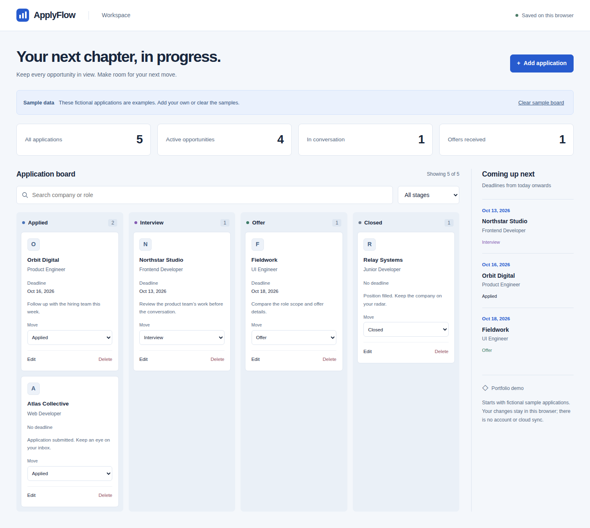

# ApplyFlow

A browser-local workspace for tracking job applications and the next step for each opportunity.



[View the mobile screenshot](docs/screenshots/mobile.png). Both images were captured from the running app by the passing browser CI workflow.

## What it does

- Add, edit, and delete applications with company, role, optional HTTP/HTTPS job URL, stage, calendar-date deadline, and notes.
- Move between Applied, Interview, Offer, and Closed with labeled controls.
- Combine company/role search with a stage filter, see stage totals, and review upcoming deadlines.
- Confirm removals, preserve changes after reload, and recover explicitly from invalid saved data.

## Run locally

Use Node.js 24 and npm. No environment variables, API keys, or backend setup are required.

```sh
npm ci
npm run dev -- --webpack
```

Open [localhost:3000](http://localhost:3000). If your environment limits file watchers, use `WATCHPACK_POLLING=true npm run dev -- --webpack`.

## Check and build

```sh
npm run lint
npm run type-check
npm test
npm run build
npm start
```

The build script uses Next.js's supported Webpack option. To run the checked-in desktop Chrome and Pixel 7 workflows:

```sh
npx playwright install chromium
npm run test:e2e
```

The [verified CI run](https://github.com/lahcen-aloui/applyflow/actions/runs/38146725554) passed lint, strict type checking, all 48 unit tests, the production build, and all 22 browser cases across desktop Chrome and Pixel 7. The desktop and mobile screenshots above come from that run.

## Stack and structure

Next.js 16 App Router, React 19, strict TypeScript, CSS variables and inline styles, ESLint, Vitest, and Playwright. Dependency versions are pinned in `package-lock.json`. UI text lives in `locales/en.ts`; calculations and storage validation live in `lib/`; focused client components live in `components/`. Icons and fonts require no external asset service.

## Demo data and persistence

The first visit starts with five fictional applications. Clear the sample board to start empty; resetting unreadable saved data also creates an empty board. Data is stored under `applyflow.applications.v1` in this browser's localStorage. There are no accounts or cloud synchronization. Clearing browser data removes the board. A failed save leaves edits visible for the current visit and offers a retry; invalid existing data stays intact until an explicit reset.

Saving requires a browser supporting [Web Locks](https://developer.mozilla.org/en-US/docs/Web/API/Web_Locks_API) on HTTPS or localhost. Each app serializes writes across tabs on the same origin and checks the exact loaded payload inside the lock, including first-visit seeding, retries, and confirmed resets. If another tab changes saved data, this tab pauses writes and keeps its in-memory state and form drafts. Choose **Discard drafts and load saved data** to explicitly replace that state with the latest validated snapshot. A stale reset confirmation is rejected; corrupt or unsupported payloads are never treated as a first visit or silently overwritten. Without Web Locks, saving fails with an explicit notice rather than using an unsafe fallback. No automatic merging is provided.

## Design and validation choices

The blue/slate board stacks stages on mobile and does not depend on dragging. Deadlines are normalized calendar-date strings, compared as local dates and formatted without UTC conversion. An open tab refreshes today at local midnight and when visibility changes, while keeping search and stage filters. Required fields are trimmed, calendar dates are checked, and saved application fields are decoded before rendering.

Unit tests cover guarded concurrent writes, failed-save retry snapshots, explicit reload/reset recovery, validation, combined filters, stage movement/counts, local-day deadline ordering, storage shape validation, storage failures, and dialog focus and keyboard boundaries. Pending application saves disable editing and dismissal; failed saves preserve the draft and restore the controls.

The passing browser suite checks application flows and actual screenshot capture on desktop and mobile. It also checks two pages in the same context/origin for stale updates, deletion/reset, queued writes, failed-save retries, draft preservation, and corrupt data; dialog initial focus, focus containment, Escape dismissal and return focus; recovered writes followed by reload; and absence of application runtime errors on every page. Both captured images were inspected for layout, clipping, and overflow.

## Dependency audit

The latest audit found no production dependency vulnerabilities. One unpatched development-only advisory remains in the Next ESLint plugin’s glob dependency chain: [braces stack exhaustion](https://github.com/advisories/GHSA-vfj7-8cjw-p6xm). The suggested downgrade would move the lint plugin to Next 14; matching Next 16 tooling is retained. These tools process trusted project files and patterns.

## AI assistance

Built with AI assistance for implementation, tests, and documentation. The source and limitations are documented here; this project makes no claim about production usage or business results.

## Author

By [Lahcen Aloui](https://github.com/lahcen-aloui).

[MIT license](LICENSE).
